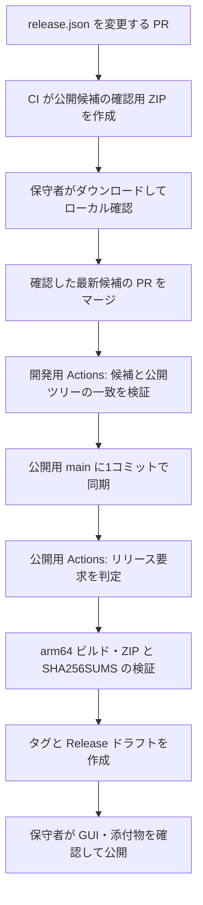

# TAK-41: ソースの公開から配布まで GitHub 上で行う案

**Date**: 2026-11-06
**Status**: 2リポジトリを維持し、release.json を変更する PR のマージをリリース開始にする方針。実装と本番設定は未実施。
**Issue**: [TAK-41](https://linear.app/takyoshida/issue/TAK-41)
**Baseline**: 開発用 `origin/master` の `03c80bc`。

## 今回の要望

開発用の変更をローカルの `publish.sh` で公開用へ書き出す運用をやめ、GitHub 内で完結させる。
前回案の「ローカルで書き出し・コミット・push してから、公開用 Actions がビルドする」という前提を見直す。

環境切り替え後の checkout に前回の未 push コミット `f0b768f` は存在しない。
このメモは新しい環境で、会話と現行の実装をもとに作成した改訂案である。
前回の仕様・計画一式を復元できたとは扱わない。

## 方式の選択

| 方式 | GitHub 上での処理 | 公開用の構成 |
|---|---|---|
| 2つを維持（提案） | Actions が公開対象を作り、公開用へ同期する | 仕様・エージェント設定を除いたソースを維持 |
| 1つに統合 | 開発用リポジトリから直接配布する | 開発用文書も含むリポジトリが製品の入口になる |

2つを維持すれば、TAK-40・TAK-80 の「開発用と、プレーンな配布用を分ける」という方針を引き継げる。
両方とも既に公開リポジトリなので、分離は秘密情報の保護を意味しない。
1つに統合する場合は、配布場所・README・既存タグと Release の移行を別途設計する必要がある。
保守者の回答により2つを維持する。通常の master 更新では同期せず、
`release.json` を変更する PR のマージをリリースの意思表示とする。

## GitHub 上の通常の流れ

- 通常操作からローカルの `publish.sh`、公開用の手動コミット・push を外す。
- 通常の入口は `release.json` 変更 PR の master へのマージとする。
  通常の PR や master 更新では同期しない。`workflow_dispatch` は復旧用に残す。
- PR の検証では公開用へ書き込まず、マージ後のイベント SHA を公開対象に固定する。
- 公開用の内容に差分がなければコミットを作らず、配布も再実行しない。
- ソースだけの更新では公開用の内容を同期しても、アプリの配布物は更新しない。
  配布する version / build / notes を明示する要求ファイルを追加・更新したときに配布する案を維持する。
- 公開用 workflow の管理元は `scripts/dev/oss-workflows/` とし、公開側の `.github/workflows/` に配置する。
- 自動化は Release ドラフトまでとし、展開したアプリの確認と公開は保守者が行う案を維持する。

## マージ前のローカル確認

PR の CI で公開候補からアプリ ZIP を作り、checksum・候補 metadata とともに取得できるようにする。
保守者は手元でビルドせず試し、最新候補を確認してからマージする。
公開側への同期前に最新 PR head と成功 run の関係、公開 tree の一致を検査し、不一致なら停止する。
最終 ZIP は公開済みコミットから同じツールチェーンと条件で再ビルドする。

## 同期処理の分離

1. 開発用 `.github/workflows/sync-public.yml` を追加する。
2. `publish.sh` の生成・選別・検査を `scripts/dev/export-public.sh` などの副作用のない処理へ分ける。
   入力はイベントの完全な source SHA、出力は一時ディレクトリの公開用ツリーと照合情報とする。
3. `.gitattributes` の除外、README の開発用注記の除去、公開用 workflow の配置と内容照合、
   混入・公開されない文書へのリンクの検査を継承する。
4. 公開されるツリーで build、通常の Core / App テスト、性能テスト、通信 API の検査を順に行う。
   既存 FR-311 の性能テストの必須条件を、今回の同期移行だけで緩めない。
5. 検証済みツリーを同じ実行の artifact として書き込み専用 job へ渡す。
   書き込み job は渡されたソースや build script を実行せず、ツリーの照合と同期だけを行う。
6. 公開用 main の現在のコミットを親として、公開用ツリーを1コミットで確定し、通常の更新を行う。
   開発用の Git 履歴は取り込まない。実行サマリーから source SHA と公開用 SHA を追跡できるようにする。
7. 検証失敗なら公開用 main を更新しない。生成 artifact のハッシュ不一致でも停止する。

`publish.sh` を残すか削除するかは、移行時に決める。
通常の公開をローカル処理に依存させず、残す場合も復旧用であることを明示する。
ランナー上の HOME / ユーザー名の検査だけでは保守者のローカルパスの検出を代替できないため、
既存検査を引き継ぎつつ、公開ツリーでのホームパス表現の検査を検討する。

## 認証と後続 workflow

開発用の `GITHUB_TOKEN` は公開用リポジトリの更新に利用できない。
公開用 `yoshidax/folzio` のみへインストールした GitHub App の短期トークンを用いる案とする。

- App の権限は公開用の Contents write と、workflow ファイルの同期に必要な Workflows write。
- 開発用には App の client ID を変数、秘密鍵を Secret として設定する。
  App トークンの対象リポジトリは `folzio` と明示する。
- Secret は同期の書き込み job だけに渡し、PR・fork の検証 job には渡さない。
- App トークンによる公開用への push を、公開用のリリース workflow の push トリガーにつなぐ。
  通常の `GITHUB_TOKEN` による push では後続 workflow が起動しない点も考慮する。
- 公開用のタグ・ドラフト作成は、公開用自身の `GITHUB_TOKEN` の contents write を使う。
- 今の Cloud セッションの `FOLZIO_GITHUB_TOKEN` を、Actions に設定済みの Secret とは扱わない。

App の作成、インストール、Secret 登録、公開用 main の保護規則との整合は、コードと設定手順を整えた後の導入作業とする。
本メモの調査では認証情報の登録やリポジトリ設定の変更を行っていない。

## 再実行と競合

- 同期をリポジトリ単位で直列化し、進行中の書き込みを後続 push で取り消さない。
- 古いイベントや古い実行の再実行で、公開済みの新しい source SHA から古い内容へ戻さない。
  候補が開発用 master に含まれることと、公開済み source SHA より古くないことを照合する。
  実行中に開発用 master が先へ進んでも、選んだイベント SHA の配布は継続できる。
- 検証時に取得した公開用 main が書き込み前に変更されていれば、変更を取り込んで上書きせず停止する。
  更新時も非 fast-forward を許可せず、強制更新しない。
- 同期済みの同じツリーは成功扱いの省略とする。タグと Release は既存内容を上書きしない。
- 同期は成功したが配布に失敗した場合、公開用の元の workflow を再実行する。
  公開用 main が先へ進んでいても、配布対象は元のイベントのコミットに固定する。

## 確認された追加条件

- 公開用との分離は維持する。
- 開発用 master のすべての更新から自動同期する案は採用しない。
- 任意のリリース時点で release.json 変更 PR を作り、マージ後の同期とビルドを GitHub Actions で行う。
- 先の手動起動案は復旧用に位置づけ、通常の開始操作はリリース PR のマージとする。

## 実装へ進む前に反映するもの

- TAK-41 の spec / plan / tasks は、確認用候補・同期・最終ビルドの流れへ改訂・再作成した。
- `overview.md` の FR-169・A-96（手動の公開用コミット・push）、FR-311・312（検証の場所と順序）、
  必要なら FR-179（従来 CLI の扱い）と `contracts/scripts.md` の変更を feature 仕様に明記する。
- TAK-40 の workflow の管理元と公開境界は維持する。
- 同期の異常系・無差分・古い実行・書き込み競合と、配布の再実行をテスト対象にする。
- 実装承認前には製品仕様の正本と本番リポジトリを変更しない。

## 参照した一次資料

- [GitHub: GITHUB_TOKEN の権限と後続イベント](https://docs.github.com/en/actions/concepts/security/github_token)
- [GitHub: workflow から後続 workflow を起動する](https://docs.github.com/en/actions/how-tos/write-workflows/choose-when-workflows-run/trigger-a-workflow)
- [公式 GitHub App トークン Action](https://github.com/actions/create-github-app-token)
- [GitHub: Git reference の更新と権限](https://docs.github.com/en/rest/git/refs#update-a-reference)
- 現行の `scripts/dev/publish.sh`、`.gitattributes`、TAK-40 の設計と製品仕様。
