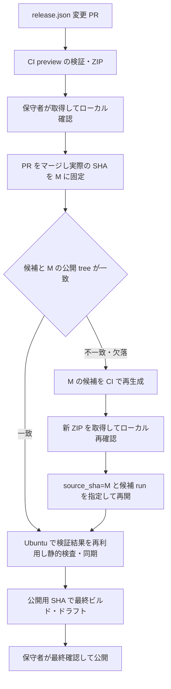

# TAK-41: GitHub 上の公開と配布 — 設計変更メモ

**Date**: 2026-11-06
**Status**: レビュー指摘10件を反映した設計案。実装・本番設定は未実施。
**Issue**: [TAK-41](https://linear.app/takyoshida/issue/TAK-41)
**Branch**: `agent/tak-41-release-design`（Cloud のローカル checkout は work）
**Baseline**: 開発用 origin/master の03c80bc。

## 確認された要望

- 開発用とプレーンな公開用の2リポジトリを維持する。
- 通常の master 更新では公開用へ同期せず、release.json 変更 PR をリリースの起点とする。
- 通常操作からローカル publish.sh・公開用の手動コミットと push を外す。
- CI のアプリ ZIP を取得して、保守者がローカル PC で試せるようにする。
- 検証済みの公開用ソースから最終ビルドし、GUI・添付物を確認して公開する。

## 通常の流れと、マージ結果が変わった場合

PR を最新 master に必ず追従させる、という保護規則の変更は行わない。
そのため別 PR のマージによる候補のずれは想定する。一致しないコードを確認済みとせず、
実際の M を固定して再生成・再確認する正常な分岐として扱う。
通常経路はマージ後に自動同期するが、再候補を作った場合は確認待ちで止まり、手動の再開を待つ。

## 検証の場所と回数

- 候補 CI が静的検査・build・Core / App 通常テスト・性能テスト・通信 API・package を順に実行する。
- 性能テストだけは既存 macOS CI と同じ非ブロッキング。失敗・タイムアウトとログを metadata / summary に記録する。
- その他の必須検査に失敗した時点で中断し、後続の検査・成果物確定・公開を行わない。
- 同期では同じ source / public tree に対する候補 CI の成功を再利用し、Ubuntu の静的処理だけを行う。
- 公開側は公開済み SHA の通常テストと最終 package。通常は macOS 2段階。
  preview と M が違う場合だけ、別コードの確認用ビルドを追加する。

これは FR-311（overview.md）の変更として、性能の例外・即時中断・候補検証の再利用まで全文を定義する。
contracts/scripts.md の旧「同期後にテストする」記述も反映タスクで更新する。

## 固定 SHA、初期化と競合

- 手動の候補生成と同期は source_sha を必須にする。workflow の ref は master でも、対象は入力 M を使う。
- M が master の祖先であり、release.json を変更したマージ済み PR の merge commit であることを検査する。
  後続の通常コミット M+3 を、同じ version とノートで暗黙に公開しない。
- artifact 名はイベント共通で release-candidate-<source_sha>-<run_id>-<run_attempt>。
  手動で PR イベントがなくても一意に決まり、source / run / attempt を追跡できる。
- 初回に source trailer がなければ自動更新しない。
  保守者が実際の公開用 main と一致する bootstrap_public_base を指定した手動同期だけを許可する。
- 同期を repo 共通の concurrency group に入れない。既定の pending 置換でリリースを失わせない。
  書き込み直前の public base・source の再照合と非 force 更新で競合を拒否し、理由と再実行先を残す。
- 同一ツリーは通常は無差分で省略。初回だけ source 対応付けの1コミットを作り、次回から通常判定を使う。

## 公開境界と認証

exporter が既存の除外・README 調整・公開 workflow 配置と静的検査を引き継ぐ。
公開用 workflow の管理元は引き続き scripts/dev/oss-workflows/。公開版は公開ファイルだけで動作する。
writer だけが、公開用に Contents write / Workflows write を持つ App の短期トークンを使う。
PR・候補・静的検査には App Secret を渡さず、受け取った source を writer で実行しない。
公開用の main 保護が更新を拒否する場合は停止し、迂回設定を自動追加しない。
初回の App・Secret と保護規則の設定は保守者の導入作業とする。

## 配布と入力

公開側は単一公開 SHA を使い、同一 SHA のタグだけ再利用する。既存 Release を自動上書きしない。
version と build の各数値は0単独以外の先頭0を拒否し、文字列を勝手に補正しない。
最終 ZIP は公開済みコミットから再ビルドし、候補との tree・両バージョン・toolchain の一致を確かめる。
アドホック署名と ZIP の時刻を含むバイト列の一致までは要求しない。

## 参照

- [GITHUB_TOKEN の権限と後続イベント](https://docs.github.com/en/actions/concepts/security/github_token)
- [workflow から後続 workflow を起動](https://docs.github.com/en/actions/how-tos/write-workflows/choose-when-workflows-run/trigger-a-workflow)
- [公式 GitHub App トークン Action](https://github.com/actions/create-github-app-token)
- [Git reference の更新と権限](https://docs.github.com/en/rest/git/refs#update-a-reference)
- [concurrency の pending 置換動作](https://docs.github.com/en/actions/how-tos/write-workflows/choose-when-workflows-run/control-workflow-concurrency)
- 現行の repository-and-release、macOS CI、FR-311（overview.md）と contracts/scripts.md。
